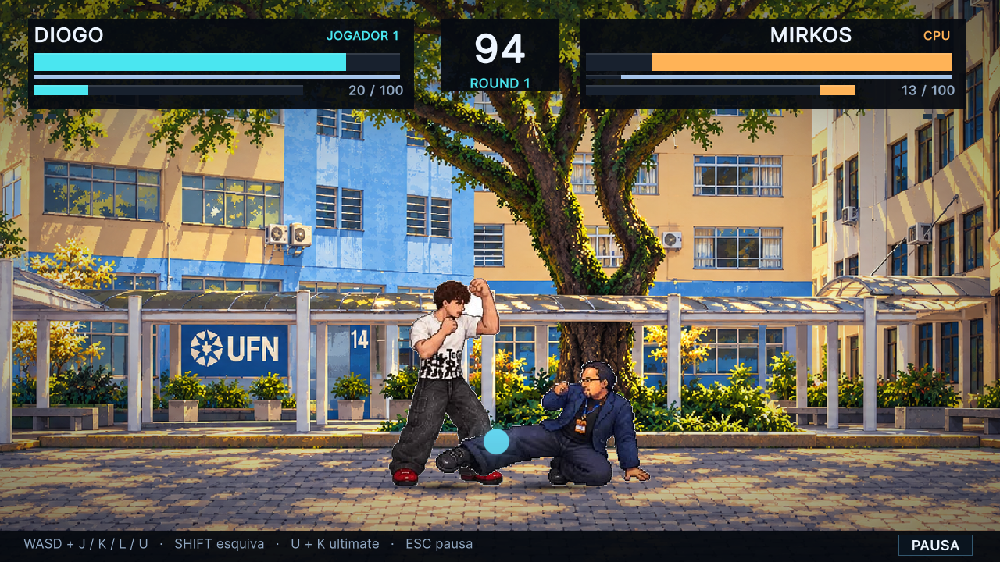
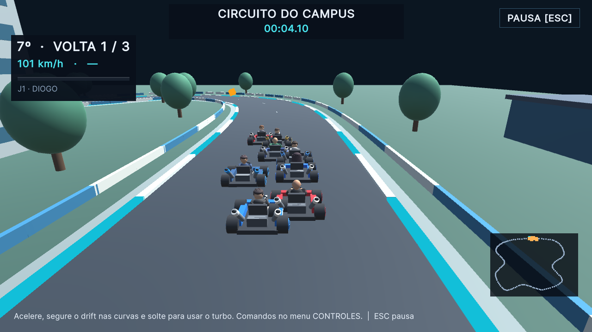

# UFN Combate — Unity Edition 0.7.0

Jogo de luta 2D e kart do campus, desenvolvido em C# com Unity 6.3 LTS. A edição Unity parte do conteúdo e das regras da versão 0.6, que permanece preservada em [seu repositório original](https://github.com/diogolibinacio200-coder/ufn-combate-0.6.0).

**Diogo Careca é uma skin do Diogo.** Usa o mesmo personagem, poderes, atributos e progresso; não ocupa outro lugar no elenco.

## Baixar e jogar no Windows

Consulte os arquivos publicados na [página de versões](https://github.com/diogolibinacio200-coder/UFN-Combate-Unity/releases).

- `UFN-Combate-Unity-v0.7.0-Windows.zip`: jogo para Windows 64 bits.
- `UFN-Combate-Unity-v0.7.0-Codigo.zip`: projeto Unity editável, código C#, conteúdo e testes.

Extraia **todo** o ZIP do Windows e abra `UFNCombateUnity.exe`. Mantenha a pasta `UFNCombateUnity_Data` e as bibliotecas ao lado do executável. Para jogar, não é necessário instalar Unity, Godot ou o SDK .NET.

O estado de validação da distribuição está em [RELEASE-NOTES.md](docs/RELEASE-NOTES.md). A aprovação dos testes de lógica não substitui a verificação do executável, da imagem e dos controles.

## Capturas do executável





As imagens acima são capturas do jogo Windows distribuído. Mais telas estão em [docs/screens/player](docs/screens/player).

## O que está implementado

| Área | Conteúdo |
| --- | --- |
| Elenco | 14 personagens jogáveis, André CSTH e Kelvin como chefes; skin Diogo Careca e transformação de Mirkos |
| Combate | Golpes próprios, comandos relativos ao adversário, combos, agarrões, esquiva, defesa alta/baixa, defesa perfeita, aparo, projéteis e ultimates |
| Arcade | Oito rivais e os dois chefes, em partidas de melhor de três rounds |
| Torre UFN | Escolha de 3, 5, 8 ou 10 rivais, seguida pelos dois chefes; mapa da torre, retomada e encerramento animado |
| Versus | Duelo local para duas pessoas ou confronto contra CPU |
| Duplas | Equipes 2 × 2, vida e energia individuais, troca manual e substituição após nocaute |
| Torneio local | Chave para quatro ou oito participantes, cada um humano ou CPU, incluindo confrontos entre personagens iguais |
| Sobrevivência | Um round por rival, vida restante com recuperação de 180 HP e pontuação acumulada |
| Torre Evolução | Modalidade adicional com escolha de benefícios entre confrontos, separada da torre clássica |
| Treino e tutorial | Oponente configurável, gravação de comandos, vida/energia/guarda infinitas, visualização de colisões e tutorial com dez etapas |
| Kart | Cinco pistas, corrida rápida, campeonato de quatro etapas e contra o relógio; até duas pessoas em tela dividida; drift, itens e 14 poderes próprios |
| Biblioteca | Galeria, lista de golpes e tempos, estatísticas, conquistas e último replay com verificação de sincronização |
| Opções | Áudio, resolução, qualidade, efeitos, textos, entrada por jogador e remapeamento de controles |

Os oito cenários 2D, atlas e áudio reaproveitados mantêm seus arquivos originais. A apresentação acrescenta câmera, sombras, partículas e efeitos, sem mudar a identidade do elenco. O núcleo de combate avança a 60 passos por segundo, separado da taxa de renderização.

## Controles padrão

As teclas abaixo valem antes de remapear os controles. Frente e trás acompanham a posição do adversário.

| Ação de combate | Jogador 1 | Jogador 2 | Controle, padrão Xbox |
| --- | --- | --- | --- |
| Movimento / pulo / agachar | W A S D | Setas | Direcional ou analógico esquerdo |
| Ataque leve | J | Num 1 | X |
| Ataque forte | K | Num 2 | Y |
| Chute | L | Num 3 | A |
| Defesa | U | Num 4 | LB |
| Esquiva | Shift esquerdo | Num 0 | B |
| Ultimate | I ou defesa + forte | Num 5 ou defesa + forte | RB ou LB + Y |
| Troca de dupla | O ou defesa + chute | Num 6 ou defesa + chute | View/Select ou LB + A |

Agarrão: defesa + leve. Especiais: trás + leve; trás + baixo + leve; frente + baixo + chute. Golpe ofensivo: frente + baixo + forte. Consulte a lista de golpes para nomes, custos e alternativas de execução.

No modo sem teclado numérico, J1 usa F/G/H/R para leve/forte/chute/defesa, T para ultimate e Y para troca. J2 usa J/K/L/U, I para ultimate, O para troca e Shift direito para esquiva. Movimento continua em WASD e setas.

O kart possui **vínculos separados da luta**, que podem ser remapeados sem alterar os golpes:

| Ação de kart | Jogador 1 | Jogador 2 | Controle, padrão Xbox |
| --- | --- | --- | --- |
| Direção | A / D | Setas esquerda/direita | Direcional ou analógico esquerdo |
| Acelerar | J | Num 1 | X |
| Frear / ré | K | Num 2 | Y |
| Drift | L | Num 3 | A |
| Usar item | U | Num 4 | LB |
| Lançar para trás | Segurar S ao usar item | Segurar seta para baixo ao usar item | Segurar direcional para baixo ao usar item |
| Recuperar kart | F2 | Backspace | Clique no analógico direito |

A recuperação retorna ao último checkpoint validado e aplica penalidade; não concede uma volta. A opção sem teclado numérico aplica F/G/H/R ao kart de J1 e J/K/L/U ao de J2. A configuração de dispositivos oferece seleção dos eixos, zona morta e inversão; os vínculos vigentes aparecem na tela de controles.

Menus aceitam mouse e navegação por teclado/controle. Enter confirma, Esc volta ou pausa, F11 alterna a tela cheia. No treino: F1 alterna energia infinita; F2 mostra colisões; F3 troca o comportamento do oponente; F4 grava/repete comandos; F5 reinicia; Tab abre as opções.

## Progresso e versão anterior

Os dados da edição Unity ficam em `%USERPROFILE%\AppData\LocalLow\Diogo Liberalesso Inácio\UFN Combate Unity`. Perfis, opções e progresso têm arquivos próprios. O perfil principal mantém uma cópia `.bak` para recuperação.

Na primeira inicialização sem progresso Unity, o importador procura `%APPDATA%\Godot\app_userdata\UFN COMBATE\profile.json`. Ele importa dados compatíveis, como estatísticas, opções, torre e campeonato, e preserva uma cópia textual do conteúdo anterior. **O arquivo Godot é somente lido.** Saves incompletos ou incompatíveis podem não ser retomáveis; a cópia original permanece disponível.

## Abrir e editar o projeto

1. Instale **Unity 6000.3.26f1**, com suporte de compilação para Windows. Ative uma licença Unity válida para sua situação.
2. No Unity Hub, use **Add project from disk** e selecione a pasta que contém `Assets`, `Packages` e `ProjectSettings`.
3. Aguarde a importação dos pacotes e assets. Abra `Assets/Scenes/UFN.unity` e pressione Play.
4. Se precisar recriar a cena de entrada, use **UFN → Preparar projeto**. Esse comando recria a cena principal e seu prefab; salve alterações manuais antes de executá-lo.

As versões de Input System e Unity Test Framework estão fixadas no manifesto de pacotes. O renderer usa os shaders incluídos no projeto. A execução do jogo não depende do Godot; o importador histórico de assets é apenas uma ferramenta de desenvolvimento.

Para gerar o Windows pelo PowerShell, com o projeto fechado no editor:

```powershell
$unity = 'C:\Program Files\Unity\Hub\Editor\6000.3.26f1\Editor\Unity.exe'
& $unity -batchmode -nographics -quit -projectPath (Get-Location).Path `
  -executeMethod UFN.Editor.BuildTools.BuildWindows -logFile build-windows.log
```

A saída padrão é `Builds/Windows/UFNCombateUnity.exe`. O processo pode levar alguns minutos; confirme `UFN_BUILD_RESULT Succeeded` no log. Também é possível compilar pela interface de Build Profiles, usando a cena principal e Windows 64 bits.

## Executar as verificações

O SDK **.NET 10** é necessário somente para os testes externos. Use PowerShell 7 ou Windows PowerShell com as ferramentas instaladas:

```powershell
# Lógica C# e testes EditMode no Unity:
./tools/run-validation.ps1

# Somente lógica C#, sem abrir Unity e sem exigir licença Unity:
./tools/run-validation.ps1 -SkipUnity

# Caminhos de instalações não padrão:
./tools/run-validation.ps1 -DotNetPath 'D:\Ferramentas\dotnet.exe' `
  -UnityPath 'D:\Unity\6000.3.26f1\Editor\Unity.exe'
```

O script gera logs e resultados em `Builds/Validation`, interrompe em erro e exige um XML EditMode com testes realmente executados. Feche o editor antes de rodar a etapa Unity. O workflow GitHub executa apenas a suite C#; ele não comprova a renderização nem substitui os testes Unity.

Organização do código:

| Caminho | Responsabilidade |
| --- | --- |
| `Assets/UFN/Core` | Regras C# de combate, kart, progressão, perfil e replay |
| `Assets/UFN/App` | Navegação, controles, áudio, menus e integração dos modos |
| `Assets/UFN/Presentation` | Apresentação da arena, pilotos, karts, câmera e efeitos |
| `Assets/StreamingAssets/Content` | Catálogo, atlas, cenários e áudio |
| `Assets/Tests/EditMode` | Testes no Unity Test Framework |
| `tests/UFN.Tests` | Testes externos de combate, modos, kart e progressão |

Consulte também [contrato do combate](docs/CORE-API.md), [progressão clássica](docs/CLASSIC-PROGRESSION.md) e [migração do kart](docs/KART-MIGRATION.md).

## Limites desta edição

- Os pilotos dos karts são modelos procedurais estilizados, inspirados nas referências fornecidas. Não são esculturas 3D idênticas às ilustrações; as referências estão preservadas em `docs/kart-references`.
- Não há multiplayer online. O multiplayer disponível é local.
- A entrada por controle está implementada, mas controles físicos e sua compatibilidade entre modelos ainda não foram verificados nesta máquina.
- Os replays verificam entradas e hashes da mesma versão de catálogo. Não há promessa de compatibilidade entre versões, plataformas ou arquiteturas diferentes.
- Testes automatizados cobrem regras e regressões específicas. Não constituem certificação de qualidade AAA, equilíbrio competitivo ou migração integral verificada em todos os percursos.

## Autoria e materiais

Criado por **Diogo Liberalesso Inácio**, com desenvolvimento assistido por IA e materiais fornecidos pelo autor. [Procedência e licenças da base](LICENSES-ORIGINAIS.md). Os direitos de imagens, fontes, marca institucional e demais materiais permanecem com seus titulares; a publicação do projeto não concede uma licença geral sobre todos os assets.
